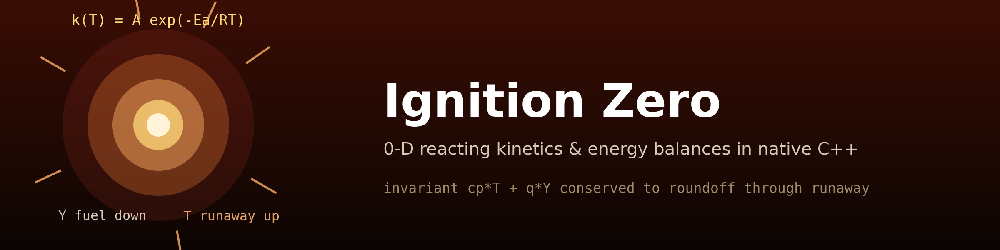
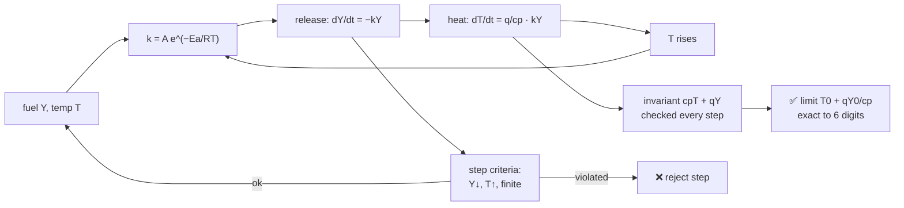
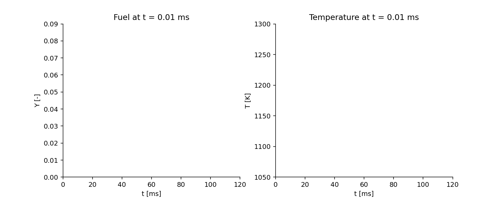

<div align="center">



# 🔥 Ignition Zero

### 0-D reacting kinetics & energy balances in native C++

**An original zero-dimensional ignition model — single-step Arrhenius chemistry with
adiabatic coupling — whose energy invariant cₚT + qY is conserved to roundoff through
the thermal runaway, verified against the exact isothermal exponential and the exact
adiabatic limit.**

[](https://github.com/khalil-official/ignition-zero/actions/workflows/ci.yml)
[](LICENSE)
[](src)
[](docs/verification.md)
[](https://github.com/khalil-official/ignition-zero/stargazers)
[](https://github.com/khalil-official/ignition-zero/commits)

[Quick start](#-quick-start) · [Method](#-model-method-and-safeguards) · [Animation](#%EF%B8%8F-results-gallery) · [Metrics](#-results-and-metrics) · [References](#-references)

</div>

---

## 🎯 Purpose and scope

A transparent, testable 0-D ignition model in modern C++: **two ODEs, one exact
energy invariant, and integrators that reject unphysical steps instead of clipping
them.**

> Clearly illustrative chemistry — **not** a detailed fuel mechanism, not a reacting
> CFD solver, and no emission/ignition-delay validation is claimed.

| | |
| --- | --- |
| 🧪 **Chemistry** | single-step Arrhenius dY/dt = −k(T)·Y with k(T) = A·exp(−Ea/RT) |
| 🔥 **Coupling** | adiabatic dT/dt = (q/cₚ)·k(T)·Y — exothermic feedback |
| ⚖️ **Invariant** | cₚT + qY conserved exactly by construction; verified to roundoff |
| 🛡️ **Safeguards** | accepted-step criteria reject garbage (fuel increasing, temperature dropping) |
| 🧯 **Stiff path** | `integrate_quench_safe` step-halving, floor 2⁻⁶⁰·dt |

## 🧮 Model, method, and safeguards

- dY/dt = −k(T)·Y, dT/dt = (q/cₚ)·k(T)·Y, k(T) = A·exp(−Ea/(RT)); Ea and R on the
  same molar basis (units stated in the API).
- Exact properties: adiabatic invariant cₚT + qY; isothermal benchmark Y₀·e^{−kt}
  (thermostatted, no energy claim); long-time limit T₀ + qY₀/cₚ.
- RK4 with accepted-step criteria: Y ≥ 0, T > 0, finite, Y non-increasing,
  T non-decreasing (exothermic). Unstable-step garbage is rejected, never clipped.
- `integrate_quench_safe`: step-halving (floor 2⁻⁶⁰·dt) for stiff runs, same
  invariants. Error flags 0–3 documented in [docs/api.md](docs/api.md).

Full derivation and scope: [docs/model.md](docs/model.md).

### The runaway loop



## ⚡ Quick start

```bash
cmake -S . -B build
cmake --build build --config Release --parallel
ctest --test-dir build -C Release --output-on-failure   # CI gate
python examples/run_verification.py   # builds+runs the demo, plots, GIF
```

Verified with GCC 16.2.0 (WinLibs) locally and CMake+CTest CI on Ubuntu and
Windows; Python (NumPy/Matplotlib/Pillow) only builds, runs, and plots the C++
output.

<details>
<summary><b>🧱 Architecture & API example</b></summary>

```
src/ignition_zero.{hpp,cpp}   # model + integrators (the whole physics)
src/ignition_demo.cpp         # CSV-writing demo driver
tests/test_ignition.cpp       # 12 verification groups (CTest gate)
CMakeLists.txt                # portable build (CMake + CTest)
examples/run_verification.py  # build, run, figures, GIF
docs/ model.md  api.md  verification.md  results/
```

```cpp
ignition_zero::Params p{1e6, 8e4, 8.314462618, 2e6, 1200.0, 1100.0, 0.08, 1e-5, 12000};
double t[12000], Y[12000], T[12000];
int rc = ignition_zero::integrate_adiabatic(p, t, Y, T, 12000);   // 0 = OK
```

</details>

## ✅ Verification

Twelve test groups (see [docs/verification.md](docs/verification.md)): exact
isothermal benchmark, measured RK4 order, roundoff energy invariant, exact adiabatic
limit, Arrhenius self-check, input rejection, stiff quench-safe completion with
invariants, and the released-vs-sensible energy audit. A monotonicity guard added
after a real probe caught an unstable step producing
fuel-increasing/temperature-dropping garbage — that class of error is now impossible
to accept.

## ⚠️ Limitations

- Illustrative single-step chemistry; constant cₚ, constant properties.
- Explicit RK4 (with safeguards) — not a stiff solver; demonstrated on the tested
  parameter range only.
- 0-D: no transport, no mixing, no detailed mechanism, no emissions.
- No experimental comparison is claimed.

---

## 🎞️ Results gallery

<div align="center">

**▶ Watch the computed thermal runaway:**



<sub>41 frames from the computed adiabatic run (A = 10⁶ 1/s, Ea = 80 kJ/mol,
q = 2 MJ/kg, T₀ = 1100 K) produced by the native C++ sources via
<code>examples/run_verification.py</code>. The temperature settles exactly
at the adiabatic limit T₀ + qY₀/cₚ = 1233.33 K.</sub>

</div>

### 📈 Results and metrics

| Case | Metric | Value |
| --- | --- | --- |
| Adiabatic runaway (demo case) | final T vs exact limit T₀+qY₀/cₚ | **1233.333333 K — exact to 6 digits** |
| Energy invariant drift | max relative over runaway | < 1e-12 |
| Energy audit | max \|released − sensible\| | 6e-7 J/kg (of 1.6e5) |
| Isothermal vs exact exponential | max relative error | < 1e-9 |
| RK4 order (isothermal) | measured log₂ error ratio | > 3.5 |
| Stiff coarse run (A=10¹⁰, dt=10⁻³) | completes via quench-safe halving, invariant < 1e-11 | ✓ |

### 🖼️ Static figures & raw data

Raw data: [docs/results/](docs/results) — `ignition_history.csv` (raw C++
output), `energy_audit.csv`, `run_summary.json`; cover
[ignition_runaway.png](docs/results/ignition_runaway.png), audit figure
[energy_audit.png](docs/results/energy_audit.png), animation
`ignition_evolution.gif`.

## 📚 References

- Semenov / Frank-Kamenetskii thermal-explosion theory (classical context, by
  topic).
- E. Hairer, S. P. Nørsett, G. Wanner, *Solving Ordinary Differential Equations I*
  (RK4, step-size control background).
- L. Forman Williams, *Combustion Theory* (single-step kinetics context).

This repository's own code is original and MIT-licensed; see [LICENSE](LICENSE).
Plotting dependencies (NumPy/Matplotlib/Pillow) carry their own licenses.
